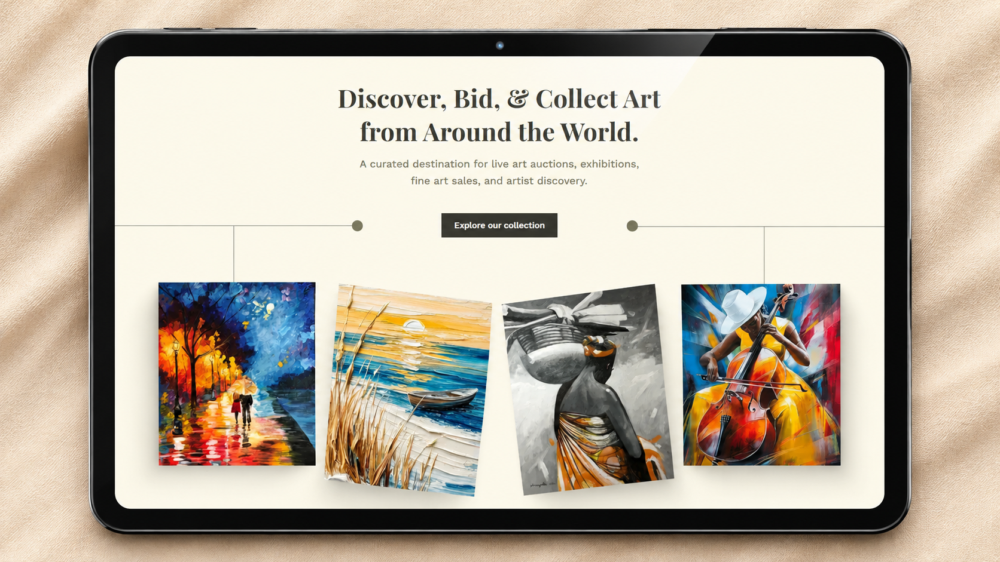

<div align="center">


</div>

---



# Edval Art Auction

A web platform for discovering original artwork, exploring live and upcoming auctions, and connecting artists with collectors. The interface brings auction listings, an art marketplace, artist submissions, exhibitions and custom artwork requests into one experience.

## Overview

Edval Art Auction is designed to make it easier for visitors to discover artwork and understand the different ways they can engage with the platform: follow live auction events, browse pieces available for direct purchase, or enquire about commissioning custom work.

## Key Features

- **Auction listings** — browse live and upcoming auction events, with artwork presented as individual lots.
- **Auction participation flow** — view auction details and access the registration interface for approved, pre-registered participants. Live bidding is described by the platform as phone-in bidding during streamed events.
- **Artwork gallery** — explore artwork listings and view individual artwork details.
- **Shopping cart** — add artwork to a cart, adjust quantities where permitted, remove items and review the cart total. Cart contents are persisted in the browser's local storage.
- **Artist submissions** — provide artist and artwork information for consideration for gallery placement, exhibitions or auctions.
- **Portrait commissions** — submit a request for personalised portraits or custom artwork.
- **Artist and exhibition discovery** — browse featured artist content and exhibition-related pages.
- **Responsive interface components** — reusable cards, navigation, sliders, tabs, modals and supporting layouts.

## Technology Stack

| Technology | Purpose |
| --- | --- |
| Next.js 16 | React framework and application routing |
| React 19 | Component-based user interface |
| CSS Modules | Component-level styling |
| Lucide React | Interface icons |
| Embla Carousel | Carousel and slider interactions |
| React Select | Enhanced select inputs |

## Getting Started

### Prerequisites

- Node.js (a current LTS release is recommended)
- npm

### Installation

1. Clone the repository:

   ```bash
   git clone https://github.com/olamadeN/portfolio-auction.git
   ```

2. Move into the project directory:

   ```bash
   cd portfolio-auction
   ```

3. Install dependencies:

   ```bash
   npm install
   ```

4. Start the development server:

   ```bash
   npm run dev
   ```

5. Open [http://localhost:3000](http://localhost:3000) in your browser.

## Available Scripts

| Command | Description |
| --- | --- |
| `npm run dev` | Start the local development server |
| `npm run build` | Create a production build |
| `npm run start` | Run the production server |
| `npm run lint` | Run ESLint |

## Project Structure

```text
app/
├── cart/                 # Shopping cart page
├── components/           # Reusable interface components
│   ├── cards/            # Auction, gallery and exhibition cards
│   ├── lotDetail/        # Auction lot information
│   ├── slider/           # Carousel and slider components
│   ├── tab/              # Tab interface
│   └── ...
├── context/              # Shared cart state
├── footer/               # Footer component
├── navbar/               # Navigation component
├── pages/
│   ├── auctions/         # Auction listings and lot details
│   ├── commissions/      # Custom artwork request
│   ├── artistRequest/    # Artist and artwork submission
│   └── ...
├── globals.css           # Global styles
├── layout.js             # Root application layout
└── page.jsx              # Homepage
public/
└── images/               # Artwork, branding and page imagery
```

## Implementation Notes

- The cart uses React Context for shared state and browser local storage for persistence.
- Artwork and auction examples are currently defined within the application components.
- The repository contains the frontend application; live auction operations, payment processing, submission handling and other server-side integrations should be configured separately where required.

## License

No licence is currently specified in this repository. Contact the repository owner before reusing or distributing the code.
